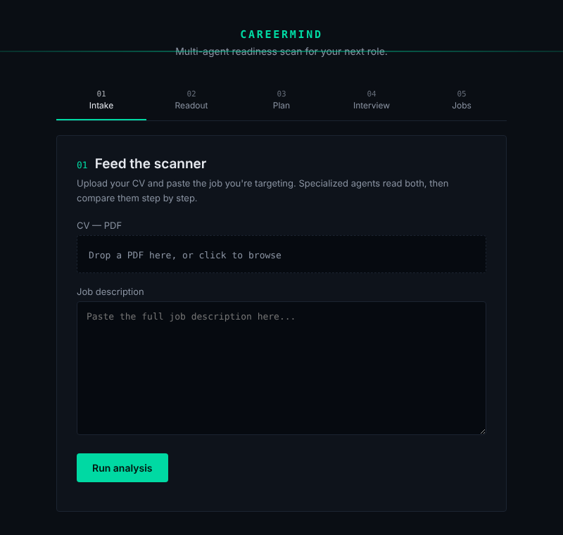

# CareerMind AI

Upload a CV, paste a target job description, and get a readiness assessment:
a job-match score, the skills you are missing and why they matter, a
week-by-week learning plan, and a mock interview based on your CV and that job.

**Live demo:** https://careermind-ai-rouge.vercel.app



## Features

- **Job match score** — compares the CV with the job description and lists
  matching and missing skills.
- **Skill-gap reasoning** — for each missing or partial skill, explains why it
  matters for this role, what to study, and a project to build.
- **Week-by-week plan** — turns the gaps into a learning roadmap.
- **Mock interview** — a chat with an interviewer agent that asks about your CV
  and the job, then returns Technical, Communication, Completeness and Overall
  scores with strengths and areas to improve.
- **Job search (optional)** — searches open roles through the
  [Adzuna API](https://developer.adzuna.com/).

Nothing is stored: results live in the browser tab and are gone on reload.

## How it works

The backend sends the CV and job description through six agents, each hosted as
a separate chatflow on AiMicromind (a hosted, Flowise-based agent builder):

```
CV Analyzer → Job Analyzer → Matching → Skill Gap → Roadmap      (one request)
                                                   Interview      (chat session)
```

1. `POST /api/full-analysis` extracts text from the PDF with
   [`unpdf`](https://github.com/unjs/unpdf), then calls the first five agents
   in order and returns their JSON.
2. `POST /api/interview/start` and `POST /api/interview/message` talk to the
   Interview agent. Every message reuses the same `sessionId`, so the flow's
   memory keeps the conversation. When the agent replies with its JSON
   evaluation, the API returns it as the final result.
3. `GET /api/jobs/search?q=…` queries Adzuna.

Each agent is asked to answer in JSON; `parseModelJSON` in
`services/aimicromind.js` also accepts JSON inside code fences or surrounded by
text.

## Project structure

```
career-mind-app/backend/
├── server.js              Express app, static frontend, error handler
├── routes/
│   ├── analyze.js         CV + job → five-agent pipeline
│   ├── interview.js       mock interview session
│   └── jobs.js            Adzuna job search
├── services/
│   ├── aimicromind.js     chatflow client, JSON parsing, score normalization
│   └── pdf.js             PDF signature check and text extraction
├── public/                vanilla HTML/CSS/JS frontend
└── test/                  unit tests (node:test)
```

## Requirements

- Node.js 24 (the version Vercel uses for this project; 22+ also runs it)
- Six AiMicromind chatflows: CV Analyzer, Job Analyzer, Matching, Skill Gap,
  Roadmap and Interview. Their prompts live in AiMicromind, not in this repo.
- Optional: an Adzuna `app_id` / `app_key` for job search

## Setup

```bash
cd career-mind-app/backend
npm install
cp .env.example .env
```

In `.env`, replace every `REPLACE_ME` with the prediction URL of the matching
chatflow (in AiMicromind: open the chatflow → **API** → copy the URL).

| Variable | Required | Description |
| --- | --- | --- |
| `CV_ANALYZER_URL`, `JOB_ANALYZER_URL`, `MATCHING_URL`, `SKILLGAP_URL`, `ROADMAP_URL`, `INTERVIEW_URL` | yes | Prediction URL of each chatflow |
| `AIMICROMIND_API_KEY` | if your chatflows use API-key auth | Sent as a Bearer token |
| `ADZUNA_APP_ID`, `ADZUNA_APP_KEY` | no | Enables job search |
| `ADZUNA_COUNTRY` | no | Job market code, default `gb` (Egypt is not supported by Adzuna) |
| `PORT` | no | Default `3000` |

## Run

```bash
npm start      # http://localhost:3000
npm run dev    # restarts on file changes
npm test       # unit tests
```

## Deployment

To deploy on Vercel, set the project's root directory to
`career-mind-app/backend` and add the same environment variables in the
project settings.
Uploads are capped at 4 MB to stay under Vercel's request-size limit.

## Limitations

- No database or accounts — results are lost on reload.
- The full analysis runs five agent calls in sequence, so it can take a while.
- Answer quality depends on the prompts configured in each AiMicromind chatflow.
- If an agent's reply can't be parsed as JSON, the error message includes the
  start of the raw reply; tighten that agent's system message to return JSON only.
